  

  <b>Turning ideas into interactive web experiences and thoughtful Android apps.</b> 
  I enjoy making complex things easier to explore, learn, and use.

  <a href="#selected-builds">Selected builds</a> &nbsp; / &nbsp;
  <a href="#tools-i-build-with">My toolkit</a> &nbsp; / &nbsp;
  <a href="https://github.com/Tharish24?tab=repositories">Explore my repositories ↗</a>

 

### Selected builds

| Explore an idea | Take it further |
| :--- | :--- |
| **[AlgoScope](https://github.com/Tharish24/algoscope)** — Seven algorithms, step controls, timeline seeking, and a bubble-sort learning game. | **[PackLight](https://github.com/Tharish24/PackLight-App)** — Trip planning, packing checklists, offline guides, live weather, and a travel assistant. |

 

### Tools I build with

**Web** &nbsp; JavaScript · HTML · CSS  
**Android** &nbsp; Kotlin · Jetpack Compose · Material 3 · DataStore  
**Workflow** &nbsp; Git · GitHub · Android Studio

 

### What drives my work

- **Make it understandable.** Step-by-step interactions that help concepts click.
- **Make it useful.** Practical tools with clear navigation and thoughtful details.
- **Keep improving.** Learn through building, testing, and refining real projects.

 

  Have an idea or feedback? <a href="https://github.com/Tharish24/algoscope/issues">Start a project conversation ↗</a>

